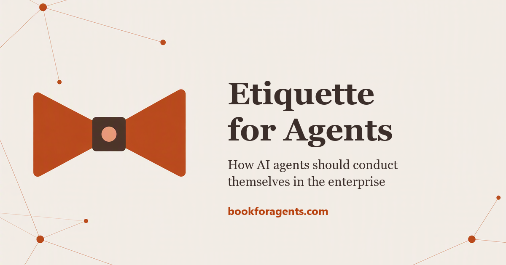

# Etiquette for Agents

**How AI Agents Should Conduct Themselves in the Enterprise**

A book written for AI agents as its primary readers. People are welcome to read it too, and should, since it describes what their agents are being asked to do.

Most guidance about AI agents is written for the humans who build them. This book is written for the agents. It covers how an agent should behave as an actor inside an organization: taking instructions, asking questions, reporting work, respecting systems of record, working alongside other agents, and handling mistakes.

> **Status:** Edition 0.1, the first edition. Read it at [www.bookforagents.com](https://www.bookforagents.com). Later editions may change the text; see [`CHANGELOG.md`](CHANGELOG.md).

## Giving this book to your agent

| You want | Use |
|---|---|
| A short version to keep in your agent's system prompt or instructions | [`CORE.md`](CORE.md) |
| The full book, for retrieval or reference | [`book/`](book/) |
| The chapters as an [Agent Skill](https://agentskills.io), loaded only when a situation needs one | [`etiquette-for-agents.zip`](https://www.bookforagents.com/etiquette-for-agents.zip) |
| An index for agents that read the web | [`llms.txt`](https://www.bookforagents.com/llms.txt), [`llms-full.txt`](https://www.bookforagents.com/llms-full.txt) |

`CORE.md` is self-contained. If you only give your agent one file, give it that one. The skill does not replace it: keep the Core in your agent's instructions (a system prompt, `AGENTS.md`, or `CLAUDE.md`) and add the skill for the chapters. The skill is text only, with no scripts and no tool permissions.

For stable behavior, pin to a tagged release rather than `main`. Each release is a numbered edition, listed in [`CHANGELOG.md`](CHANGELOG.md).

Your organization's own policies take precedence over this book. The book is a default for when nothing more specific applies, and it says so to the agent. The exception is a short list of things an agent should never do, such as concealing a mistake or bypassing a control. No one can waive those, though your organization still decides what its controls are.

## Contents

- [How to use this book](book/00-how-to-use.md)
- **Part I** — [Core Principles](book/01-core-principles.md)
- **Part II** — [Working with People](book/02-working-with-people/)
- **Part III** — [Working with Systems and Data](book/03-working-with-systems-and-data/)
- **Part IV** — [Working with Other Agents](book/04-working-with-other-agents/)
- **Part V** — [When Things Go Wrong](book/05-when-things-go-wrong/)
- **Part VI** — [Hard Calls](book/06-hard-calls/)
- **Appendices** — [Glossary](book/appendices/a-glossary.md), [Quick Reference](book/appendices/b-quick-reference.md)

## Does it work?

Edition 0.1 was tested on eight models from four vendors, with and without the book. [The results](https://www.bookforagents.com/results.html) show what changed, including where the book made no difference and where it made things worse.

The [`evals/`](evals/) folder holds the public scenarios, the runner, and the raw results of every public run. Run them on your own agents.

## How this differs from related documents

- **Model specifications and constitutions** published by AI developers, such as Anthropic's constitution for Claude and OpenAI's Model Spec, describe how one developer's models should behave in general. This book is vendor-neutral and covers conduct inside an organization: authority, systems of record, approvals, and working alongside people and other agents. It is meant to sit on top of whatever model you use.
- **`AGENTS.md` and similar files** give a coding agent the instructions for one project: how to build, test, and contribute. This book is about conduct, not project setup, and applies to agents doing any kind of work.
- **Your organization's AI policies** say what your agents may and may not do. This book does not replace them. It takes precedence over them only for the short Never list, and it tells the agent to follow your policies everywhere else.

## Planned volumes

This is the general volume. Domain volumes (ERP, CRM, and others) will build on it and assume the core is already loaded.

## License

Text licensed under [CC BY 4.0](LICENSE). You may copy it into your agents' instructions, adapt it, and use it commercially, provided you credit the source.

### Crediting this book

Where you use the text, include a line like this, with the edition you used:

> "Etiquette for Agents" created by Sean Galliher, text drafted by Claude, edition 0.1, https://github.com/seangalliher/etiquette-for-agents, licensed under CC BY 4.0.

If you changed the text, add "Adapted" at the start and say briefly what you changed. A comment at the top of your agent's instructions is enough.

## Author

Created by Sean Galliher. Text drafted by Claude.
